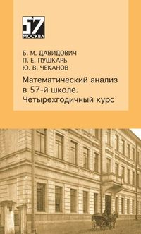

# Решения листков из книги Б.М.Давидович, П.Е.Пушкарь, Ю.В.Чеканов "Математический анализ в 57-й школе. Четырехгодичный курс".

## 📁 Структура репозитория

Все задачи сгруппированы по темам (беседам) и разделам. Для каждой задачи приведено полное условие и подробное решение, оформленное в LaTeX.

### 8 класс

1. Теория множеств

## 🛠 Инструменты

Все решения оформлены в формате **LaTeX** для удобства чтения и компиляции в PDF. 
Для компиляции используется стандартный набор пакетов `amsmath`, `amssymb`, `geometry` и поддержка русского языка (`babel`).